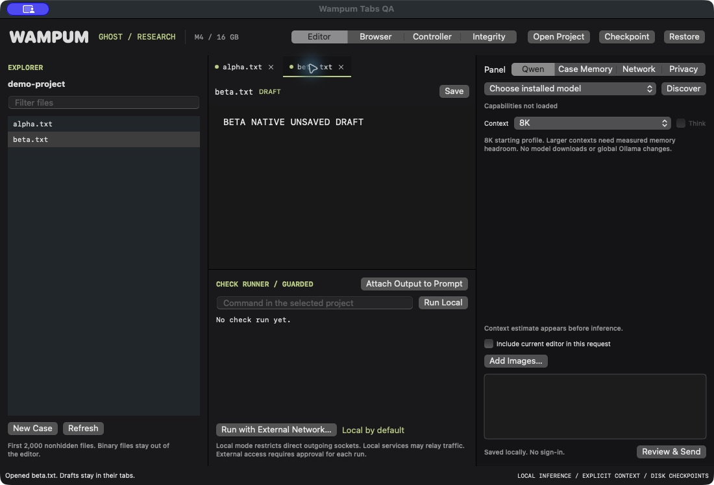

# Wampum


**Early source prototype · v0.1.1 plus October 27 source updates.** [Source and releases](https://github.com/ghostintheprompt/wampum). Built and tested for a personal red-team workflow on an M4 Mac mini with 16 GB. [Release verification](RELEASE_EVIDENCE.md). [Native release check](docs/release-editor.png).

A native macOS workbench for local security research and prototype development. Built for a Mac mini M4 with 16 GB unified memory. A companion to Avant Garde, for Ghost's research workflow.

Michael's name for the project comes from finding wampum in the mud and reeds near Kennedy Airport growing up.

## First working build

Open a project, browse text files, edit, and save with an original-content backup and a stale-write check. Ask an installed Ollama model a question. Attach the current editor explicitly. Keep scope and handoff notes in Case Memory. Review a complete-file response side by side, stage it, and save when ready. Run an explicit check command, inspect its actual output/exit code, and attach the result to the next prompt.

Drafts, messages, scope, and notes save locally. Checkpoints preserve sessions before changing projects, files, proposals, or runs. Restore a checkpoint from the app. A corrupt session is retained for recovery; unreadable recovery storage blocks automatic writes.

The starting context profile is 8K, with 4K/16K/32K options. Input-size estimates are approximate, not tokenizer counts. Older complete turns can be omitted to fit a request; the full transcript stays on disk. Oversized current input is rejected rather than silently truncated. Keep a concise checkpoint to carry old work forward. Actual prompt/output counts appear when Ollama supplies them. Thinking is offered only when the inspected model reports it.

## Build and launch

Requires macOS 14+, Xcode command-line tools, Swift, and local Ollama for model use. No third-party Swift packages.

```sh
swift test
scripts/build-app.sh
```

Open `build/Wampum.app` in Finder. It is locally ad-hoc signed, not notarized or distributed through the App Store. The model client accepts only localhost Ollama and refuses HTTP redirects. Discover retrieves real installed tags; completion models are kept separate from embedding models. No model is downloaded or renamed.

Local state: `~/Library/Application Support/Wampum/`. This includes session JSON, checkpoint JSON, file backups, and command logs. These files contain your work, in plaintext. `WAMPUM_STATE_DIR` can redirect state for development. Project edits occur only through Save. Check commands run with your ordinary macOS account. Run Local now restricts direct outbound sockets to loopback through the built-in sandbox-exec utility. External network access requires a frozen-command one-run confirmation. The runner remains neither a general security sandbox, a PTY terminal, nor a process-tree containment service. Checks now own a process group. Stop sends TERM and a short KILL fallback, and normal completion cleans remaining group members before reaping the leader. Detached children can escape. Force quit/power loss can leave commands alive; restart preserves evidence without replaying commands or signaling saved PIDs.

## Initial verification — October 25, 2026

The initial baseline passed 16 local tests (12 core and four app-model integration checks): path traversal/symlink containment, source-preserving saves and backups, stale-write rejection, create-versus-overwrite behavior, binary/large-file rejection, draft/transcript recovery, corrupt-session preservation at the storage layer, whole-turn context selection, oversized-input rejection, local endpoint restrictions, exact model-name decoding, actual nonzero command exit capture, staged-proposal save behavior, draft-switch checkpoints, and corrupt-session recovery copies.

A separate live local smoke test discovered `lukey03/Qwen3.5-9B-abliterated:latest`, inspected completion/tools/thinking capabilities, and received READY (27 prompt tokens, 2 output tokens) at 4K context with thinking disabled. That model did not report vision. The test did not benchmark red-team performance. The native app launched, rendered, and successfully discovered that model through its own Discover button. Project opening, file selection, and project restoration after app restart were also verified. One idle app-process snapshot was 130,608 KiB RSS (about 127.5 MiB); it excludes Ollama and is not a memory-pressure or long-session benchmark.

## Still being built

This version has a plain native text editor, reviewed response-to-file staging, a noninteractive check runner, scenario memory, image/OCR inputs, and reviewed single-step browser control through Playwright MCP. Syntax highlighting/LSP, Git review UI, streaming responses, general autonomous tool execution, project indexing, and a measured older-context summarizer remain implementation work. STATUS.md records the public prototype queue.

MIT licensed. This is an early source release. Build it locally with the commands above.

## Network Guard

No app account, telemetry uploader, analytics SDK, cloud fallback, or automatic update checker is implemented. Wampum's own Ollama requests pass through a loopback-only guard and reject redirects. The Network tab displays a local JSONL ledger with component, destination, decision, and purpose. It does not store model prompt bodies or URL query values. Logs are in Application Support/Wampum/network-events.jsonl, private-mode plaintext.

Check commands use Run Local by default. On this Mac the sandbox-exec profile denies direct nonlocal outbound sockets and permits loopback. If the guard executable is unavailable, the local run fails closed. Run with External Network shows the exact frozen command and warns that it and its children may contact any destination or transmit accessible data. Approval is for that run, never saved as a global allow. A command permission error under the local policy raises a review warning; it is not a proven destination-level network event.

This is not Little Snitch or a system-wide network monitor. Local services (including Ollama), DNS/system brokers, user-launched external apps, and explicitly allowed commands can relay traffic outside this app's observation. There is no per-host prompt for arbitrary subprocess connections. The macOS sandbox-exec interface is deprecated; its direct-socket behavior was measured here, not promised on future OS releases. Full process-aware connection monitoring/filtering remains a Network Extension implementation requiring appropriate Apple signing/entitlements and system approval. No such extension was installed.

Eight additional core tests verify loopback/lookalike URLs, guarded defaults, one-run plan behavior, empty-command rejection, real loopback success, real nonlocal PermissionError, query-free blocked-host logging, and local-event logging. A fifth app test verifies the external warning freezes the command without executing and cancels cleanly. Total: 26 local tests pass; the optional live generation test remains separate. Real socket tests use temporary loopback sockets and the documentation address 192.0.2.1, whose connect is denied locally.

A ninth network test starts a temporary local HTTP server returning a redirect to example.test. The client rejects the 302 without following it and records REDIRECT_BLOCKED without its query token. No nonlocal connection was attempted by that redirect test.

## Content masking and separate proxy control

Privacy has independent controls for model-content masking, approved-URL masking, and common secret-pattern detection. Add exact aliases as `real value => replacement`, one per line. Aliases are applied without cascading into one another. Every model request pauses at a frozen preview of the actual message contents, including system context, scope, checkpoint, selected history and explicitly attached editor. Confirming sends that snapshot; cancelling sends nothing. Original draft and transcript remain local and unmasked. Masked output is not automatically converted back into private values. Review code proposals because masking can change code behavior.

Patterns cover selected credential formats, bearer strings, key/password assignments and private-key blocks; they do not discover all secrets or PII. Manual rules handle client names, private paths and identifiers. This is obfuscation, not encryption, DLP certification or anonymity. Alias rules and proxy settings are private-mode plaintext in `privacy.json`. Corrupt privacy configuration blocks new model/proxy requests instead of quietly discarding your rules.

Network has a separate approved HTTPS HEAD tool. Configure `socks5://host:port`, `http://host:port` (HTTP CONNECT) or `https://host:port` (TLS to CONNECT proxy). No embedded credentials or proxy authentication in this version. Review the exact URL and route, then approve one request. URL masking can alter query text; a rule changing the destination hostname is rejected. The tool sends no project context, cookies, stored authentication or request body. Redirects are refused. It requests headers only and does not execute remote content.

Proxy configurations have `allowFailover=false`. A failing proxy ends the request instead of permitting direct retry. Proxy routing is limited to this tool; local Ollama explicitly bypasses proxies, and shell commands, browsers and future MCP do not inherit it. The broad one-run external-shell permission remains separate and is not proxy protected. No proxy server, VPN, Tor, macOS system proxy or Network Extension is installed or configured globally. The proxy operator can observe connection metadata; successful anonymity or DNS-leak prevention across arbitrary tools has not been established.

Verification: 8 masking/settings tests, 5 proxy tests, and 2 new app tests supplement the 26 prior local tests (41 local total). The actual HTTP CONNECT and SOCKS5 tests use temporary loopback proxy fixtures that reject forwarding. They record the intended destination hostname; no external origin is contacted. Review tests preserve original content locally, freeze destinations/settings, and confirm no request before approval. A successful public upstream request and TLS-to-proxy server path are not newly tested here.

## Lab scenario memory

Case Memory → Import Index accepts the existing scenario_runs INDEX.json schema (id, title, mode, status, folder). Select one scenario at a time. Each restores its project, editor draft, prompt, conversation, scope, notes and structured memory. Switching saves the outgoing scenario first, clears transient command/output state, and keeps editor attachment off. General workspace is restored separately. Finish or cancel an active request/check/review before switching.

Keep objective, observed environment, markers, attempts/results, evidence references, result status and next step concise in the scenario fields. These accompany every model request even when older conversation is omitted. Load BRIEF + STATE explicitly reads only those two files from the selected folder into the checkpoint (12 KB combined limit, prior checkpoint preserved). Review imported notes before sending. Wampum does not infer a grader pass or fresh browser state from historical notes. Browser tools run through the separate reviewed Browser workspace.

Scenario sessions and index are private-mode plaintext under Application Support/Wampum/scenarios. The original lab files are not moved or modified by import/switch. Existing session files without scenario metadata remain compatible. Optional live check: WAMPUM_SCENARIO_LIVE=1 swift test --filter ScenarioTests.

## Browser workspace and images

Choose Browser in the top bar. It gets the full workspace: the actual controlled-tab capture on the left, Actions / Page / Debug on the right. The mirror is view-only, refreshed after actions and optionally every three seconds. It is not an independently loaded website or an interactive embedded browser. The local Qwen model uses Playwright's accessibility snapshot to select elements. Model vision is not required for DOM-based browser control.

Discover selects a real installed model. Connect uses the installed official @playwright/mcp API, Node, and Chrome in a new nonpersistent context. The bundled stdio adapter owns the context directly rather than the installed CLI's detached daemon path, which failed during this build. No package download, extension install, existing Chrome-profile access, or cloud-model fallback occurs. Connection setup exposes executable paths. Debug shows runtime versions/errors, console output, rejection details and Show Local Logs.

Browser Check serves an inert diagnostic page on 127.0.0.1. It fills an objective to click Record evidence once. Review Context → Ask Qwen previews the exact model request and tool schemas. Qwen proposes at most one tool action. Review its exact arguments, then Allow This Action or Deny. No automatic action loop runs. Fresh snapshots are supplied after successful actions, avoiding redundant snapshot tool proposals. Navigation, click, type, keypress, select, back and bounded waits are supported. Console/network inspection remains available in the controller; arbitrary evaluation, server-side code, uploads and existing-profile extension attachment are not exposed by this panel.

Local-only browser mode restricts direct nonlocal sockets through sandbox-exec while permitting loopback and the connection's own short temporary Unix-socket directory. The rule was tested with a real allowed Unix connection and a real denied connection attempt to 192.0.2.1. It remains a direct-socket restriction, not a system firewall or guarantee against local-service/DNS relays. External mode requires a connection-specific confirmation and uses the ordinary network, including site third parties and redirects. Neither mode inherits the separate proxy tool settings. Optional Show a Separate Chrome Window supports manual interaction in that isolated session; the verified default is headless Chrome mirrored in Wampum.

Rejected request fingerprints use canonical JSON, persist per scenario, and block repeats. Permission/operator denials also block that tool with changed arguments until an explicit conditions-changed reset. Failed captures turn Live off. Stop/disconnect closes this owned browser context, not existing user tabs. Disconnect before changing scenarios/projects or restoring checkpoints. Browser goals and addresses persist per scenario. Logs and rejection records are private-mode plaintext in Application Support/Wampum. Browser logs can contain page text and entered values.

Add Images accepts up to two PNG/JPEG files (10 MB and 40 megapixels each), copies/normalizes them locally to JPEG with a maximum 1600-pixel edge, and shows previews before sending. Use Capture in Chat attaches the current browser image. The selected model must report vision for image requests. The currently installed lukey03/Qwen3.5-9B-abliterated:latest does not; Extract Text instead performs on-device OCR and adds its fallible output to the prompt. No image bytes are sent in that OCR path. Image requests reserve an approximate 2048 context tokens per image, not a measured tokenizer count. Pixels are not redacted by text masking. Frozen image contents are reviewed before send; local image references remain with the user message and are not automatically resent in later turns.

Verification: real installed Chrome + Playwright MCP + Qwen completed a reviewed click on a disposable loopback fixture and confirmed changed page text, capture, and console output. Image capability rejection, local OCR, frozen image review, and REST image payload serialization were tested. There is no installed vision-model inference result or live lab/grader result in this verification.

## Codex / Claude Code controller

Controller is an optional full-width workspace. It stays off on launch. Prepare Handoff shows the exact masked scenario scope, memory and checkpoint. Edit/review it, then Enable & Share Reviewed Handoff grants one controller 15 minutes, 20 action/checkpoint proposals, 120 calls and 256 KB of returned data. This bounds Wampum's interface, not the external provider's model-token bill. A controller's returned context may reach its model provider. Qwen remains local and no provider is called by Wampum's helper itself.

After building, prepare the project-only connections:

```sh
python3 scripts/configure-controllers.py
```

Start Codex with this invocation-specific configuration:

```sh
python3 scripts/codex-wampum.py
```

The wrapper is needed for this installed Codex CLI: plain `codex -C ... mcp get wampum` did not discover the project entry. The wrapper's `mcp get wampum` successfully resolves the actual helper. It does not change global settings. The project TOML remains available for clients that support it. Claude Code recognizes the project .mcp.json entry and currently reports Pending approval: start Claude Code in this checkout and approve the project MCP entry through its normal UI. No client trust/approval was bypassed, no global account configuration was edited, and no external assistant turn was started during setup. Machine-specific client files are gitignored.

The real helper is build/Wampum.app/Contents/MacOS/WampumController. Its stdio MCP server exposes status, approved handoff, browser-action proposal, observation request/read, checkpoint submission, and stop. It has no general shell/file tool and cannot allow its own proposal. Native Browser Allow/Deny uses the same validation and rejection gate as Qwen. A denied browser tool cannot be rephrased with new arguments to bypass that denial.

Observation requests return a ticket, not the page. Review/edit the exact observation in Controller before Share This Observation makes it readable. Checkpoint submissions also stay pending until accepted into Case Memory, marked as controller submissions rather than independently verified findings. Revoke & Stop Browser removes the current capability and stops the owned browser workflow. Expiry or changing scenario revokes the connection. After enabling a new connection, reconnect the client: an existing helper process never silently adopts the new capability.

The helper and GUI communicate through private local request/response files in Application Support/Wampum/controller. No TCP listener, account or public endpoint is added. This scopes the MCP interface; it does not isolate another same-account program from files its own macOS permissions already allow, or recall data already returned to a provider. Approved response files are consumed by the helper. Do not place these local state files in a public repository.

Opt-in integration test: WAMPUM_CONTROLLER_LIVE=1 swift test --filter ControllerAppTests. It uses the actual helper and installed Playwright/Chrome on a loopback fixture, manually exercises the same operator-review methods, checks changed page state and receipts, then revokes. It is not a live Codex/Claude model session or a client-lab result.

## Browser execution receipts and recovery

Each sent browser action now has a receipt with independent tool execution, page refresh and screenshot states. A successful click remains successful if a later snapshot or screenshot fails. A transport loss is recorded as outcome unknown, never guessed as success or safe to repeat. Tool-reported errors remain distinct from requests blocked before sending. Browser and controller displays use the same receipt summary.

Intent is saved before calling the tool. On restart, an interrupted in-flight request becomes unknown and cannot be repeated until the operator inspects conditions and explicitly acknowledges them through the reset control. A previously saved tool success stays successful even if observation collection was interrupted. Nothing is automatically replayed. Stale DOM observations are not used for new Qwen proposals or shared as fresh controller observations.

Recent receipts live under Application Support/Wampum/browser-receipts/<scenario>/recent.json (last 100), with private-mode capture files and SHA-256 references. Receipt metadata stores a hash of canonical tool arguments rather than their raw form values; existing browser activity logs still contain action arguments. Hashes support checking the saved bytes, not an immutable or independently signed forensic chain. Storage errors block new actions and preserve unreadable history for repair. Owned command-group termination and warmed local-Qwen request cancellation/recovery are now tested separately. Owned browser/MCP group cleanup is now tested; deliberate detachment and broader containment remain open.


## Build record: one machine, one workflow

Wampum is a personal cybersecurity proof of concept. The target is Michael's own research/prototype workflow on the computer he already owns. It is not a complete replacement for VS Code, a system-wide firewall, a certified forensic recorder or a measured red-team benchmark. The source is MIT licensed; this source snapshot is prepared for an early prototype release. There is no app account, analytics uploader or hosted inference fallback.

| Component | Actual development configuration |
| --- | --- |
| Hardware | Apple M4 Mac mini, 16 GB unified memory, verified locally |
| Development OS/toolchain | macOS 26.6.2, Apple Swift 6.4, arm64 |
| Declared deployment target | macOS 14+, not tested across every supported release |
| App | SwiftUI/AppKit, native text editor, no third-party Swift packages |
| Local inference | Ollama 0.33.2; exact installed `lukey03/Qwen3.5-9B-abliterated:latest`, Q4_K_M, 9B |
| Reported model capabilities | completion, tools, thinking; no vision |
| Context policy | 8K starting profile; 4K/16K/32K choices, approximate input estimates, whole-turn history selection |
| Images | Local copies and OCR; image pixels blocked for a model not reporting vision |
| Browser | Installed Playwright MCP/Chrome, isolated owned session, native screenshot/DOM/diagnostics pane, reviewed single calls |
| Persistence | Plaintext local sessions, checkpoints, logs and receipts; private permissions do not encrypt them |
| Distribution so far | Local ad-hoc-signed app; no notarized/public binary release |

The first foundation commit is dated October 25, 2026, at 21:23 New York time. The October 26 checkpoints below show the order of development. These timestamps document commits, not continuous working hours, a billing record or a comparison against another developer.

| Checkpoint | Commit | Implementation or evidence |
| --- | --- | --- |
| Foundation | `6738cc0` | Local model calls, editing, safe saves and durable sessions |
| Native interaction repair | `02ed68c` | Real app use exposed an explorer interaction defect |
| Network boundary | `2cd5a71`, `5ff10bf` | Loopback client, one-run external command grant, redirect refusal |
| Scenario memory | `fa522d9`, `a0436bd` | Separate scenario state and persisted rejected-tool reasons |
| Visible browser | `8f805a5` | DOM/screenshot/console evidence and local image inputs |
| Controller interface | `70cc0b7` | Scoped helper, reviewed sharing, proposals and revocation; external provider turns untested |
| Independent outcomes | `da1d632` | Execution, refresh and capture states saved separately |
| Check ownership | `2107cf5` | Owned process groups, child cleanup, active HTTP cancellation and interruption recovery |
| Integrity comparison | `a216618`, `7e035c9` | Bounded hashes, preserved baselines and a native comparison workspace |
| Installed-model recovery | `460d950` | Warmup/cancellation/next-request measurements separated from cold loading |
| Approval/source links | `1c968c4` | Exact-call approvals plus separate page/request hashes in receipts |

The implementation has already forced corrections. The installed model did not report vision, so image support could not be asserted by toggling a setting. A successful browser action followed by a failed screenshot needed two outcomes instead of one retry. Signaling only a shell left children behind, so checks acquired owned process groups. A model recovery probe timed out, and a later successful probe showed roughly ten seconds of cold loading. Warming before cancellation made the next regression measurable, without establishing the historical timeout's cause. A cross-repo test assumed a Homebrew Node path that did not exist here; it now uses the executable detected by the app.

For a representative warmed local-model run, cancellation returned in 0.00464 seconds and the next READY response arrived in 0.3776 seconds. That is one short synthetic request on this machine, not a long-session or server GPU-stop benchmark. The first model/context integrity baseline covered one manifest, four referenced blobs and 14 context files. All declared blob digests matched, and the immediate comparison found no changes. A first baseline says nothing about the original third-party model's trustworthiness.

## Reproduction and evidence

Run the portable-to-this-macOS-project tests and build:

```sh
swift test
scripts/build-app.sh
```

Opt-in local checks use the actual installed services and synthetic/local fixtures:

```sh
WAMPUM_LIVE_TEST=1 swift test --filter LocalOllamaTests
WAMPUM_BROWSER_LIVE=1 swift test --filter BrowserAppTests.testLivePlaywrightPageCaptureAndQwenClick
WAMPUM_CONTROLLER_LIVE=1 swift test --filter ControllerAppTests
```

These are distinct evidence levels. The default suite exercises local fixtures and failure paths. Live-model tests require an installed model and may affect local load. Browser/controller tests use an owned loopback page, not a client environment. The cross-repository provenance integration uses a sibling `coding_agent_monitor_lab` checkout and installed Node, and explicitly skips that integration when its prerequisites are absent.

The isolated release snapshot default run executed 93 tests: 86 passed and 7 explicitly skipped. With local-model/browser/controller flags it passed 90 with 3 skips. The original workspace additionally tested its sibling-monitor integration. See RELEASE_EVIDENCE.md for exact scope and prerequisites. The subsequent installed-Qwen/Playwright click test passed with proposal, explicit operator approval, page change and console evidence. The monitor's separate suite passed 30 assertions and 11 replay tests. Tests are recorded by scope; none of those counts establishes professional engagement success.

## Approval and source evidence

Native Allow This Action creates a one-use exact-call/scenario approval before sending. A receipt stores hashes of current scope/notes/goal, page context and the reviewed local-Qwen request preview where available. Source text is separate from authority. Controller proposals cannot approve themselves. Legacy receipts and direct execute/navigation/refresh paths without an approval record do not gain authority retroactively.

The monitor accepts an approval link only when its call hash, independently declared scenario, ordering and one-use ID agree. It reports authority and source evidence separately. These are unsigned recorder assertions, not proof of operator identity, safe page content, contractual scope or immutable custody. Source hashes do not substitute for retaining the original evidence privately.

## Prototype release boundary

The public snapshot excludes private handoff notes/history, machine-specific client configurations, case material and runtime state. Development checkpoint IDs above refer to the original local development history; this public repository starts from a reviewed source snapshot. The public build record preserves the decisions and failures without publishing private work. The app has no account, but an opted-in external controller can use its own provider account and external tools can transmit data.

Still open: detached/reparented browser process containment, full native long-session testing, cold-cancellation/queue cases, streaming responses, project search/diffs/LSP/Git/interactive terminal, independent baseline anchoring and stronger context provenance. Build the next layer when its workflow is needed and testable. A prototype release does not turn those into shipped features.


## Browser prerequisites

The editor, local-model client and default fixture suite build without Node or browser packages. Browser control is optional and requires an installed Node executable, Google Chrome and Playwright MCP. The tested MCP version is 0.0.83. Wampum does not download those tools automatically.

To install that explicit browser dependency into a directory you control:

```sh
npm install --prefix browser-tools --no-audit --no-fund @playwright/mcp@0.0.83
```

In Browser, set Node to the actual executable from `command -v node` and the MCP server path to `browser-tools/node_modules/@playwright/mcp/cli.js` inside your checkout. Existing npm-cache installations can also be detected. Connect Local, then run Browser Check against its owned loopback page before allowing external browsing. The optional browser dependency has its own transitive packages; the Swift package has no third-party Swift dependencies. A different MCP version needs compatibility testing.

Source release only: no notarized installer, automatic updater or bundled model/browser. Build with the Xcode command-line tools. The reference development toolchain is Swift 6.4 on macOS 26.6.2; the declared app target is macOS 14+. Earlier toolchains/OS releases are not a verified matrix.


### Native release QA correction

The first public source cut passed its fixture/service checks, then native QA from a temporary checkout exposed inconsistent `/tmp` and `/private/tmp` path aliases. The explorer trimmed incorrect relative names, and resolution needed the same canonical form on both sides. Version 0.1.1 canonicalizes enumeration and resolution, with two regression tests covering alias roots, Unicode project names and safe saves. Native QA then opened a listed source file, discovered the actual installed model, reviewed the exact request and saved a real READY response (185 prompt tokens,2 output tokens). This correction is retained in the build record.

## Browser transport shutdown — October 27, 2026

MCP now launches in an owned process group. Disconnect closes its pipes, signals the group, allows up to three seconds for graceful shutdown and then escalates to KILL if needed. Natural server exit also cleans remaining group members before reaping its leader. Disconnect waits for tracked shutdowns; repeated calls cannot report completion while an earlier cleanup remains pending. Cancelled callers still wait, and a pending request fails without an automatic retry. Pipe readers own duplicate descriptors and cancellable polling, preventing an old reader from consuming a replacement connection's data.

Two real-process regressions cover TERM-ignoring children/grandchildren, cancelled/repeated Stop, an unaffected unrelated process, replacement connections and natural server exit with inherited pipes. A separate opt-in test opened the installed Playwright adapter and an isolated Chrome instance against an owned loopback fixture: all eight observed transport/browser descendants exited. It made no model call. Native Browser Check and Disconnect were also exercised in a separately identified app with temporary state; the displayed result was `Disconnected. Owned MCP transport stopped.`

This owns the spawned group, not every possible descendant. Deliberate setsid/setpgid escape, reparented helpers outside the observed tree, force quit/power loss and complete OS-level containment remain open. The existing browser profile, network approvals and no-cloud-fallback policy are unchanged.

Repeat the regression with `swift test --filter MCPProcessTests`. The actual browser check is `WAMPUM_BROWSER_LIVE=1 swift test --filter BrowserAppTests.testLiveBrowserTransportDescendantCleanup`; it requires the existing Node/Playwright/Chrome setup and installs nothing.


## Editor tabs and draft recovery — October 27, 2026

Open files remain as named tabs. Each retains its own draft and last-read disk baseline; switching tabs does not write either project file. Tab order, selection and drafts are saved with the session and separately for each scenario. Older one-file sessions become a tab without losing their draft. Only the explicitly attached current editor enters a model request, not every open tab.

The active tab has an underline; unsaved tabs have a dot. Closing a clean tab selects a neighbour. Closing an unsaved tab offers Save and Close, Discard Draft, or Cancel. Save and Close writes only that file and retains the existing outside-change check. Discard leaves the project file alone and keeps a recovery checkpoint accessible through Restore. Storage/checkpoint failures block destructive transitions. Review sheets block tab switching so a file proposal cannot change targets mid-review.

Eight regressions cover multiple drafts/restart, active-only and background saves, outside edits, clean/dirty closes, checkpoint retention, failed storage/proposal staging, legacy sessions, missing files and scenario isolation. Native review used a separate app identity and synthetic project: editing beta, switching to alpha, cancelling close, quitting/reopening, saving beta through Save and Close, and discarding alpha were exercised. Disk checks confirmed beta was saved, alpha stayed unchanged and alpha's discarded draft existed in a checkpoint. The owner's working app was not restarted.

Undo stacks and cursor/scroll positions are not persisted per tab. Switching constructs a separate editor view so undo cannot insert another file's buffer. Draft persistence uses the existing half-second session debounce and normal-quit save; abrupt termination before that save is not a zero-loss guarantee. Project content search and readable diffs are next; full LSP/Git/interactive terminal and long-session measurements remain open.



Public default verification for this editor slice: 104 tests, 96 passed, eight opt-in or private-sibling integration skips, zero failures. The private development run had 97 passes/seven skips because its sibling-monitor integration was available. No new model inference was needed to test editor persistence.
